# manyhouses: Marketing Plan | خطة التسويق

<mark>✏️ Student writes: one line saying what this plan is for, e.g. "Our entry in the Marketing category of the Afro-Asian Forum for Technology and Innovation, 2026."</mark>

> **How to use this plan:** every yellow <mark>✏️</mark> box is yours to fill in. Most offer options A, B or C. Pick one, rewrite it in your own words, and replace the whole box. Everything else comes from the app's code or from `docs/research.md`, where `[n]` is the source number. Check those numbers yourself before you present them. When you are done, run `python docs/build.py` to rebuild the PDF, the deck, the poster and the social images.

## 1. Executive Summary | الملخص التنفيذي

| Field | Value |
|-------|-------|
| **Brand** | manyhouses |
| **Category** | Real estate listings, Egypt |
| **What it is today** | A working web app (prototype) with 12 sample properties in 10 Egyptian cities |
| **Live app** | <https://many-houses.streamlit.app> |
| **Launch** | Nationwide, with a near-zero, organic budget |
| **The ask** | Try the app, and brokers and owners: list your first real homes with us |
| **One-line pitch** | <mark>✏️ Student writes: one sentence. Options: A "manyhouses puts homes from Alexandria to Aswan in one simple search." · B "The property search for every city the big portals skip."</mark> |
| **Team** | <mark>✏️ Student writes: names, school, and who did what</mark> |

## 2. Situation Analysis | تحليل الوضع

### The market | السوق

| Fact | Number | Source |
|------|--------|--------|
| People living in Egypt | 108 million (Aug 2025) | CAPMAS [1] |
| Marriage contracts | 936,739 in 2024 | CAPMAS via the press [3], [4] |
| Internet users | 98.2 million, 82.7% of people | DataReportal [5] |
| Social media users | 51.6 million | DataReportal [5] |
| Residential market size | US$9.81 billion in 2025, about 9% growth a year. One estimate; others are much higher. | Mordor Intelligence [9] (check) |
| Top-20 developer sales | About EGP 1.6 trillion in 2025, but 7% fewer units | EnterpriseAM [11], Zawya [12] |
| Market direction | Top-10 developer sales fell 6.5% in Q1 2026 | Daily News Egypt [13] |
| The pound | About EGP 31 → about EGP 50 per US$ on 6 Mar 2024 | Reuters via Arab News [16] |
| Money from Egyptians abroad | US$36.5 billion in FY2024/25, a record | CBE via Daily News Egypt [20] |

**What it means for us.** Many people need homes, and nearly everyone is online. The big portals and the money behind them sit in Greater Cairo compounds. On Dubizzle, about 157k of the 200k+ property ads are in Cairo [37]. Property Finder's featured projects cost EGP 12.4M–73.5M [32].

### Competitors | المنافسون

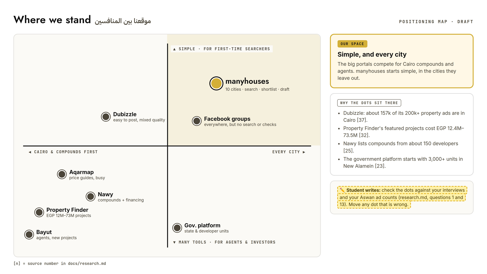

| | Aqarmap | Property Finder EG | Nawy | Dubizzle EG | Facebook groups | **manyhouses** |
|---|---|---|---|---|---|---|
| Type | Portal | Portal | Brokerage, portal and finance | Classifieds | Social groups | Prototype |
| Makes money from | Pro subscriptions, ad packages [29] | Agent subscriptions [35] | Sales and financing [25] | Featured ads [42] | Boosted posts | Not yet |
| Size (company claims) | 247k listings [28] | Group: US$525M stake [34] | US$52M Series A [25] | 200k+ ads [37] | 51.6M reach [5] | 12 sample listings |
| Focus | Cairo, compounds | New projects, agents | Compounds | Everything | Local, informal | 10 cities, simple |
| Gap we can use | Busy, prices not public | Expensive end | Few flats outside compounds | Mixed quality | No search, no checks | — |

Two more to watch: **Bayut Egypt** (launched Oct 2023 [40]) and the **government platform** (launched Feb 2025 to remove duplicate and fake listings [24]).

### SWOT | تحليل نقاط القوة والضعف

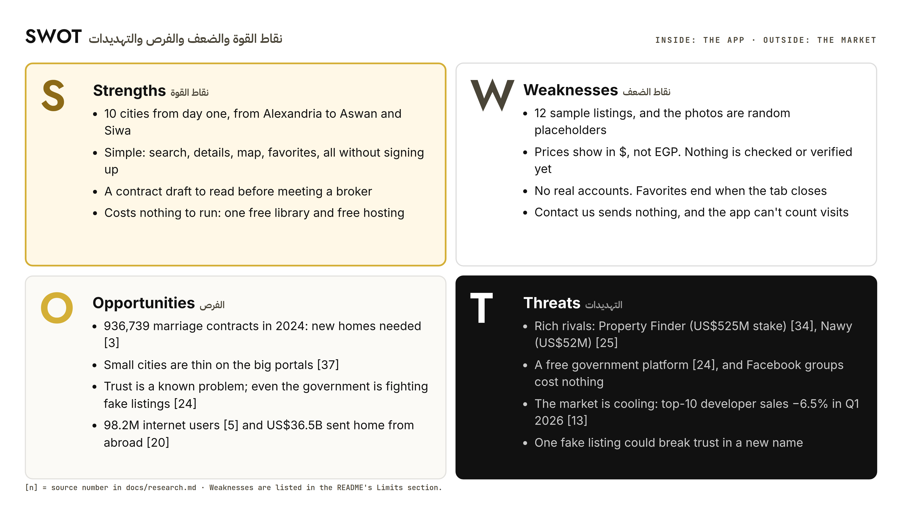

## 3. Target Audience | الجمهور المستهدف

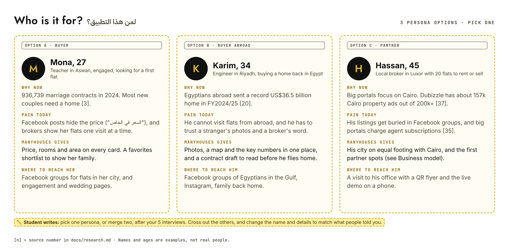

- **Primary audience:** <mark>✏️ Student writes: pick a persona. Options: A newly married couples outside Cairo (Mona) · B Egyptians abroad buying back home (Karim)</mark>
- **Partners:** local brokers and owners (Hassan). They bring the first real listings.
- **What people told us:** <mark>✏️ Student writes: 2–3 things you heard in your 5 interviews (research.md, questions 1–8). Write their words, not names.</mark>

### Customer Journey | رحلة العميل

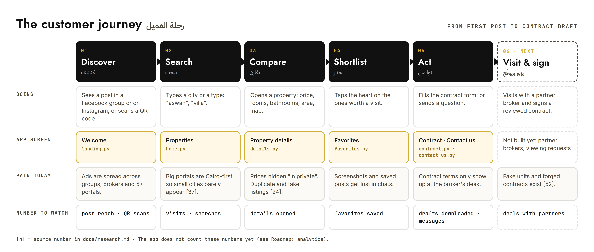

## 4. Positioning & Brand | التموضع والهوية

**Positioning statement.** For <mark>✏️ Student writes: your audience, e.g. "families looking for a home outside Cairo"</mark>, manyhouses is the property search that covers every city simply. It shows the price, rooms and area up front, keeps a shortlist, and drafts the contract. Big portals focus on Cairo compounds and agents.

| Brand element | manyhouses |
|---------------|------------|
| Tagline | <mark>✏️ Student writes: pick or rewrite. A "Every city. One search." · B "Your key to any city." · C "بيتك في أي مدينة"</mark> |
| Mark | A house outline whose wall turns into a key (`images/many_houses_logo.jpeg`, redrawn as `docs/assets/mark.svg`) |
| Colours | Gold `#D4AF37`, ink `#111111`, cream `#FFF8E7` (the app's `.streamlit/config.toml`) |
| Fonts | Jost for headlines, Inter for body text, IBM Plex Sans Arabic for Arabic |
| Voice | <mark>✏️ Student writes: 3 words. Options: A clear · warm · honest · B simple · local · confident</mark> |
| Name story | <mark>✏️ Student writes: why "manyhouses"? 2–3 sentences</mark> |

The full brand guide is `docs/brand/manyhouses-brand-guide.pdf`.

## 5. Marketing Mix (4Ps) | المزيج التسويقي

### Product | المنتج

What the app does today, from its code:

| # | Feature | What it does | Screen |
|---|---------|--------------|--------|
| 1 | Search | Finds properties by name, city or type. Shows a friendly message when nothing matches. | Properties (`app_pages/home.py`) |
| 2 | Property cards | Photo, type, city, price, rooms, bathrooms and area, three cards per row | Properties |
| 3 | Property details | Four key numbers, a details box and a map pin | Property details (`app_pages/details.py`) |
| 4 | Favorites | Heart buttons on cards and details. One page lists them all, with remove buttons. | Favorites (`app_pages/favorites.py`) |
| 5 | Contract draft | Sale or rent form. Checks the name, national ID and phone, that the end date is not before the start date, and the confirm box. Then you download a `.txt` draft. | Contract (`app_pages/contract.py`) |
| 6 | Contact form | Checks the name, email and message, then says thank you | Contact us (`app_pages/contact_us.py`) |
| 7 | Information pages | Welcome, FAQ (8 questions), About | `landing.py`, `faq.py`, `about.py` |
| 8 | Sign in / Register | Check that the boxes are filled, then open the listings | `login.py`, `register.py` |

| Search "villa" | Property details |
|----------------|------------------|
| 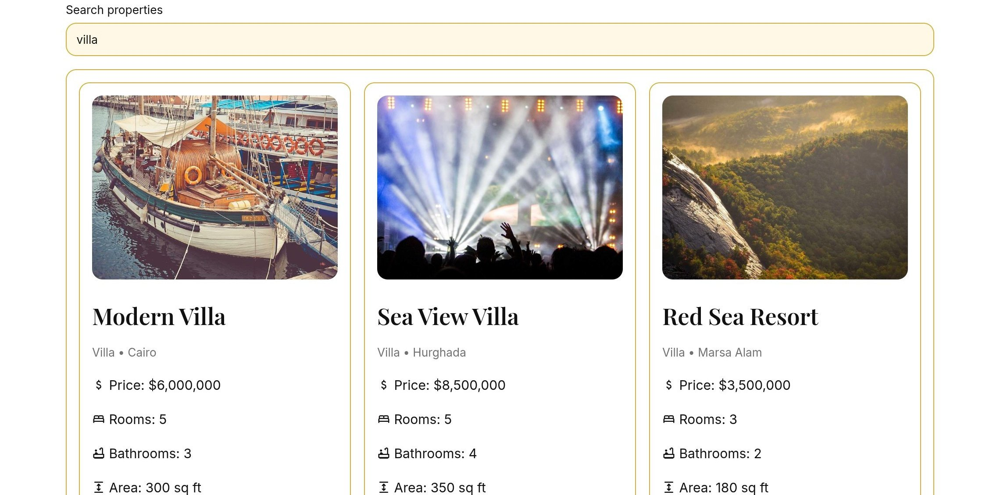 | 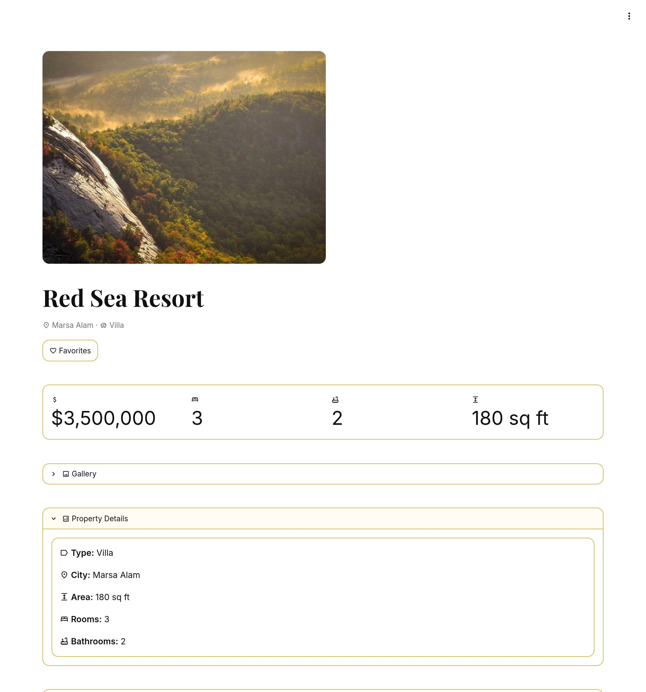 |

| Favorites | Contract |
|-----------|----------|
| 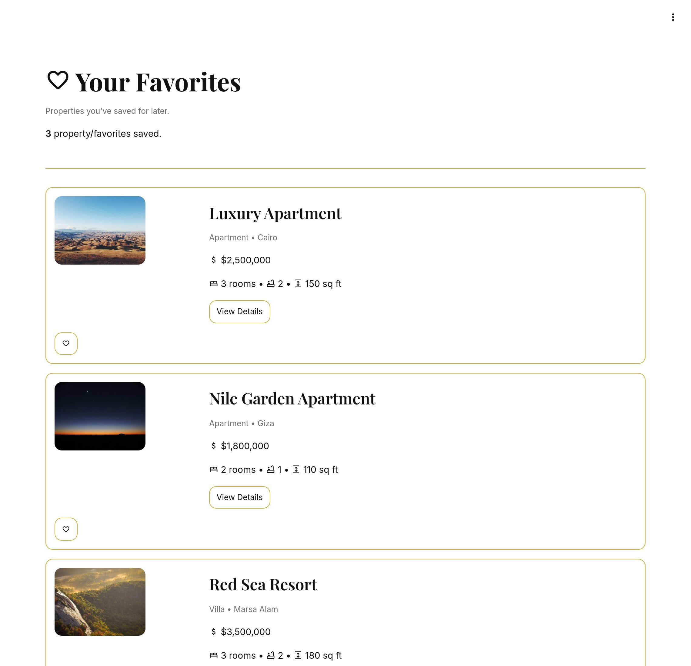 | 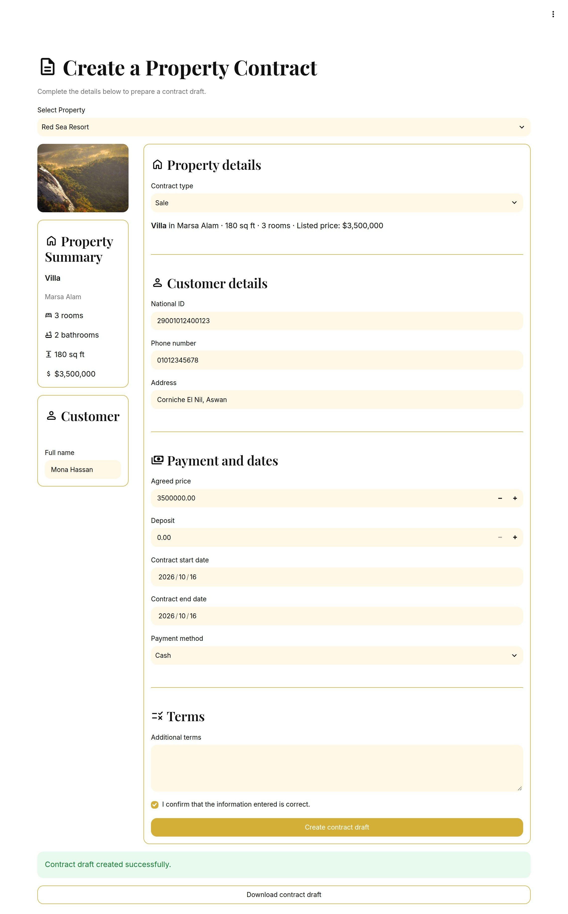 |

### Price | السعر

Searching is free. How manyhouses will earn money:

| Option | How it works | Good | Hard |
|--------|--------------|------|------|
| **A. Featured listings** | Free to list, pay to be pinned at the top of a city | Easy to explain, like Dubizzle [42] | Earns only once there is traffic |
| **B. Founding partners** | The first brokers in each city list free for 6 months, then pay a small monthly fee | Brings real listings now, and recurring income later, like Property Finder [35] | Brokers must see leads first |
| **C. Success fee** | No fee to list; a share of the broker's fee when a deal closes | Low risk for brokers | Hard to track; check the broker rules [45] |

`research.md` recommends starting with B, then adding A.

**Our choice:** <mark>✏️ Student writes: A, B, C or a mix, and why in 1–2 sentences</mark>

### Place | المكان

- **The web app** at <https://many-houses.streamlit.app>. It works in a phone browser, and browsing needs no account.
- **Where people meet us:** Facebook groups, Instagram, brokers' offices, and events (see Promotion).
- **Coverage:** 10 cities: Cairo, Giza, Alexandria, Hurghada, Sharm El Sheikh, Marsa Alam, Luxor, Aswan, Siwa and the New Administrative Capital.

### Promotion | الترويج

| Channel | What we do | Cost |
|---------|------------|------|
| Facebook groups | Post in the city groups where people already look for flats | EGP 0 |
| Instagram | Weekly feed posts and stories from the social kit | EGP 0 |
| Founding partners | Visit brokers and owners with a QR flyer and the live demo | Transport only |
| Events | Poster and QR code at forums, universities and community events | Printing |

## 6. Campaign & Content | الحملة والمحتوى

**Campaign idea:** <mark>✏️ Student writes: pick or rewrite. A "#MyCityToo": one home from a different city every week · B "Founding 50": the first 50 brokers list free · C "Show your city": people share the street they want to live on</mark>

### Social kit | حزمة التواصل الاجتماعي

The images are in `docs/social/`, and they are made from real app screenshots.

| Launch (Instagram) | Feature (Instagram) | Partners (Instagram) |
|--------------------|---------------------|----------------------|
| 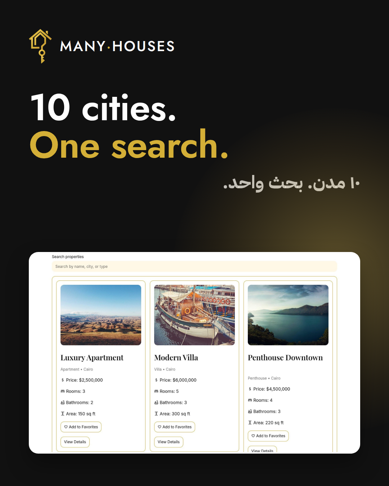 | 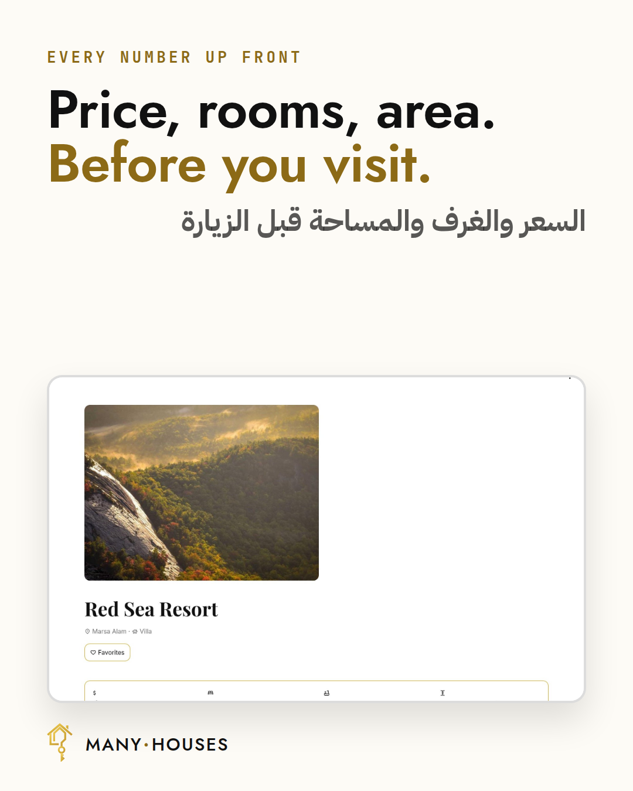 | 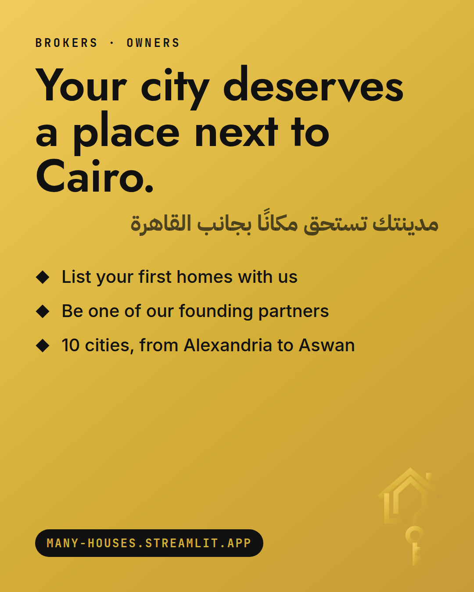 |

| Story: try it | Story: partners | Facebook link |
|---------------|-----------------|---------------|
| 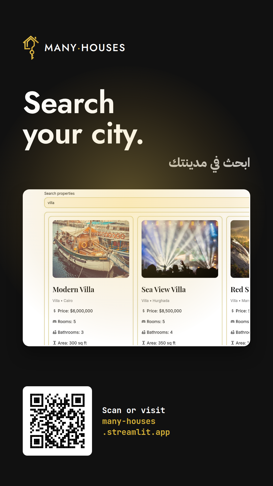 | 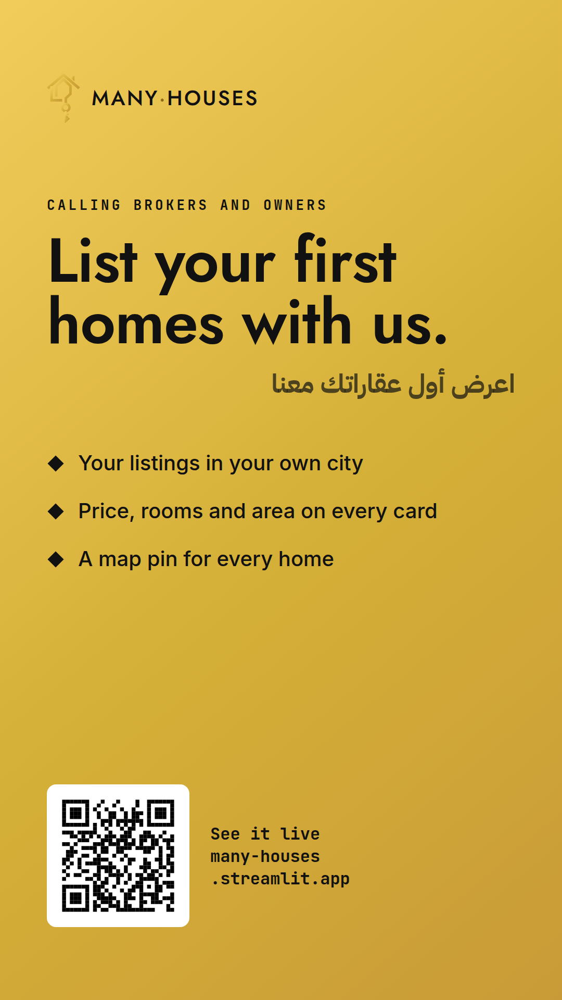 | 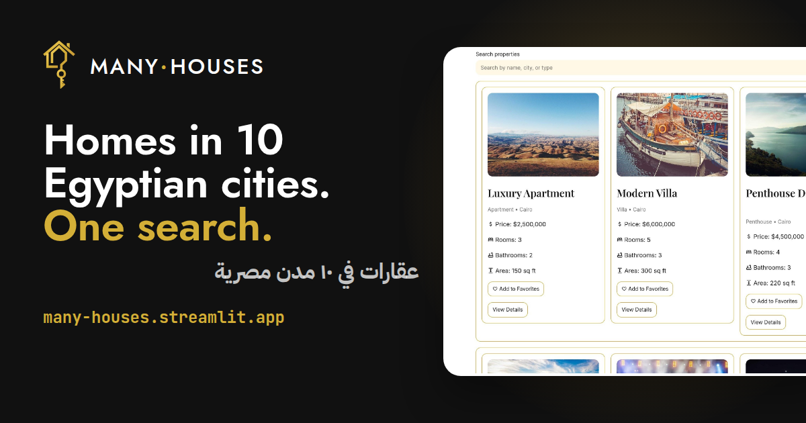 |

### Captions | النصوص المرافقة

| Post | English caption | Arabic caption |
|------|-----------------|----------------|
| Launch | <mark>✏️ Student writes: Option: "Homes from Alexandria to Aswan in one search. Try the prototype: many-houses.streamlit.app"</mark> | <mark>✏️ Student writes: the same in Arabic</mark> |
| Feature | <mark>✏️ Student writes: Option: "Price, rooms and area on every card, before you ever visit."</mark> | <mark>✏️ Student writes: the same in Arabic</mark> |
| Partners | <mark>✏️ Student writes: Option: "Brokers and owners outside Cairo: be one of our first partners. Message us."</mark> | <mark>✏️ Student writes: the same in Arabic</mark> |

### Four-week content calendar | جدول المحتوى

| Week | Post | Story | Offline |
|------|------|-------|---------|
| 1 | Launch | Try it (QR) | Tell friends and family; share in 3 city groups |
| 2 | Feature | Try it | Visit 5 brokers with the partner flyer |
| 3 | Partners | Partners | <mark>✏️ Student writes: one event or place to show the poster</mark> |
| 4 | <mark>✏️ Student writes: a post with what you learned so far</mark> | Partners | Follow up with the brokers you visited |

### Demo video (30–45 seconds) | فيديو العرض

Record the real app on a phone. Use the Stories cover (`story-try.png`) as the Reel's cover.

| Time | Show | Say |
|------|------|-----|
| 0:00 | The Properties screen | <mark>✏️ Student writes: your opening line, e.g. "Looking for a home outside Cairo?"</mark> |
| 0:05 | Type "aswan" in the search box | "Search any of 10 cities by name, city or type." |
| 0:12 | Open a property, then its map | "Price, rooms, area, and where it is." |
| 0:20 | Tap the heart, then open Favorites | "Save the ones you like." |
| 0:28 | Fill in the contract form and download | "Download a contract draft to read before you meet anyone." |
| 0:38 | The QR code | "Try it at many-houses.streamlit.app." |

## 7. Budget, KPIs & Funnel | الميزانية ومؤشرات الأداء

### Budget | الميزانية

| Item | Cost |
|------|------|
| Hosting (Streamlit Community Cloud) | EGP 0 |
| Social media posts | EGP 0 |
| Poster and QR flyers | <mark>✏️ Student writes: the printing price you were quoted</mark> |
| Transport to broker visits | <mark>✏️ Student writes: an estimate</mark> |
| **Total** | <mark>✏️ Student writes: the total</mark> |

### Funnel and KPIs | قمع التسويق ومؤشرات الأداء

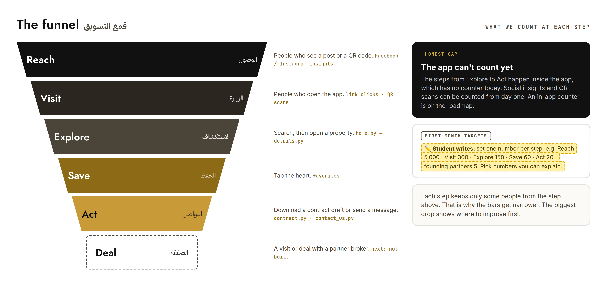

| Step | KPI | How we count it | First-month target |
|------|-----|-----------------|--------------------|
| Reach | People who saw a post | Facebook and Instagram insights | <mark>✏️ Student writes: e.g. 5,000</mark> |
| Visit | People who opened the app | Link clicks and QR scans | <mark>✏️ Student writes: e.g. 300</mark> |
| Explore → Act | Searches, favorites, drafts | Not countable yet. The app needs a counter (Roadmap). | — |
| Partners | Brokers or owners who agree to list | A list we keep by hand | <mark>✏️ Student writes: e.g. 5</mark> |

## 8. Roadmap & Limits | خارطة الطريق والحدود

The app is a working prototype. Some things it does not do yet. We show them as next steps, not as features.

| Today (built) | Next | Later |
|---------------|------|-------|
| 10 screens, live on the web | Real listings from founding partners | Accounts that keep favorites between visits |
| 12 sample listings in 10 cities | Real photos instead of placeholders | Partners add their own listings |
| Search, details, map, favorites | Prices in EGP, with installment plans [43] | A visit counter for the funnel |
| Contract draft download | A "checked by a partner" badge | An Arabic version of the app |
| Contact form (shows a thank-you) | WhatsApp contact that reaches a person | |
| **When:** now | **When:** <mark>✏️ Student writes: e.g. 3 months</mark> | **When:** <mark>✏️ Student writes: e.g. 1 year</mark> |

**Limits today** (from the README):

- The 12 listings are samples, and the photos are random pictures from picsum.photos.
- Prices show in US dollars ($), not EGP.
- Sign in and Register only check that the boxes are filled. There are no real accounts.
- Favorites and form input last only while the browser tab is open.
- Contact us shows a thank-you but sends nothing. Contact details and testimonials on the About and Welcome pages are placeholders, so this plan does not use them.
- The contract is a text draft, not a legal document.

## 9. Student Worksheet | ورقة عمل الطالب

### My Project | مشروعي

**Student name:** <mark>✏️ Student writes: your full name</mark>  
**Project:** manyhouses: Marketing Plan

### My research | بحثي

**The 5 people I interviewed searched for homes in:** <mark>✏️ Student writes: cities</mark>

**The most surprising thing I heard:** <mark>✏️ Student writes: 1–2 sentences</mark>

**Aswan ad counts I checked (research.md, question 13):** <mark>✏️ Student writes: Dubizzle __ · Aqarmap __ · Property Finder __</mark>

### My choices | اختياراتي

| Decision | I chose | Because |
|----------|---------|---------|
| Persona | <mark>✏️ Student writes</mark> | <mark>✏️ Student writes</mark> |
| Tagline | <mark>✏️ Student writes</mark> | <mark>✏️ Student writes</mark> |
| Revenue model | <mark>✏️ Student writes</mark> | <mark>✏️ Student writes</mark> |
| Campaign idea | <mark>✏️ Student writes</mark> | <mark>✏️ Student writes</mark> |

### What I Learned | ماذا تعلمت

1. **About marketing:** <mark>✏️ Student writes</mark>
2. **About my customers:** <mark>✏️ Student writes</mark>
3. **The hardest part:** <mark>✏️ Student writes</mark>
4. **If I had more time:** <mark>✏️ Student writes</mark>

---

## Appendix: How the Product Works | ملحق: كيف يعمل المنتج

The app is one Python program built with Streamlit, its only library. It runs free on Streamlit Community Cloud. The 12 properties live in one list in `data.py`. Favorites and the picked property live only in the browser session.

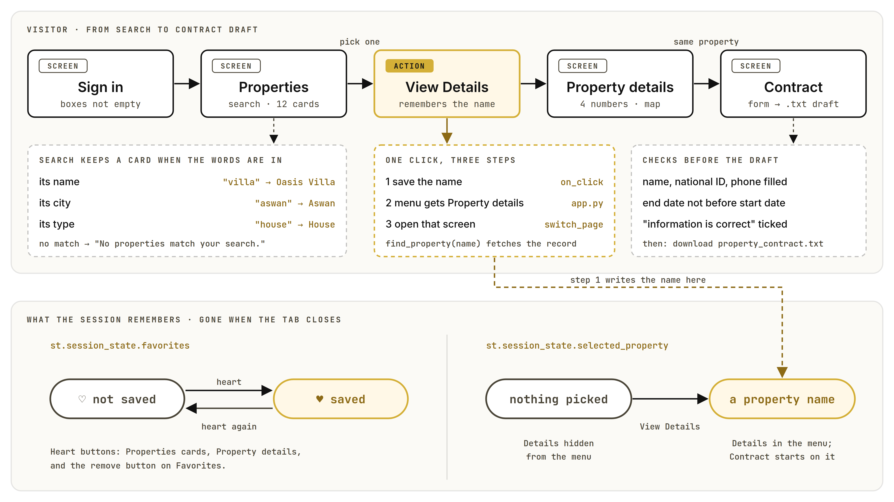

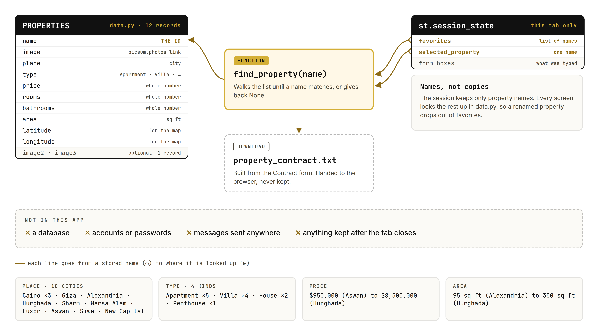

**Sources:** every `[n]` in this plan is numbered in `docs/research.md`, with the publisher, date and link.

Try the app: <https://many-houses.streamlit.app>

---

<mark>✏️ Student writes: team or school name · event · year</mark>
